  

<h1 align="center">Hi, I'm Samhith V Gupta 👋</h1>

  <b>B.Tech Computer Science & Engineering @ Presidency University, Bengaluru</b> 
  I build AI-powered web apps — from idea and design to a live, deployed product.

  
  
  
  

  

---

### 🚀 About me

- 🎓 Second-year CSE student at **Presidency University, Bengaluru**
- 🤖 I love building with **Generative AI** — multi-agent systems, AI assistants and smart dashboards
- 🌱 Most of my projects tackle real problems: legal access, civic decision-making, sustainability and clean energy
- 🧑‍🤝‍🧑 Class representative and active in technical events
- 📫 Reach me at **samhithvgupta@gmail.com**

### 🏆 Recognition

- 🥇 **DST INSPIRE Award** recipient
- 💡 Selected among **NITI Aayog's Top 100 ATL Tinkerpreneurs**
- ✨ Shortlisted for **Google's Gemini Student Ambassador Program 2026**
- 🌍 **3rd place globally** — GraphRAG medical AI built on TigerGraph (team project)

### 🛠️ Tech stack

  
  
  
  
  
  
  
  
  
  
  
  
  

### 🌟 Featured projects

| Project | What it does | Live |
|---|---|---|
| [**NyayaLens**](https://github.com/SVG700/NyayaLens) | AI-powered legal document understanding & assistance platform (Next.js + Gemini) | [Demo](https://nyayalens-pink.vercel.app) |
| [**StadiumOS AI**](https://github.com/SVG700/StadiumOS-AI) | Smart stadium operations platform for FIFA World Cup 2026, powered by Generative AI | [Demo](https://stadium-os-ai-topaz.vercel.app) |
| [**CivicMind AI**](https://github.com/SVG700/CivicMind-AI) | Multi-agent decision-intelligence platform for municipal and emergency teams | [Demo](https://civic-mind-ai-xi.vercel.app) |
| [**EcoBuddy AI**](https://github.com/SVG700/ecobuddy-ai) | Mobile-first PWA to track and cut your carbon footprint with Gemini tips | [Demo](https://ecobuddy-ai-eight.vercel.app) |
| [**HelioHub**](https://github.com/SVG700/HelioHub) | Smart solar charging station platform with a Gemini AI assistant and live dashboard | [Demo](https://helio-hub.vercel.app) |
| [**PayPerView (Web3)**](https://github.com/SVG700/Web3-Youtube-Decentralised-Platform) | Semi-decentralised video platform with IPFS storage and Algorand payments | [Demo](https://ffrg-srgvs.vercel.app/) |

<b>More projects</b>

- [**EventVibe**](https://github.com/SVG700/EventVibe) — helps groups find events that suit everyone's interests and locations (Firebase)
- [**Lume**](https://github.com/SVG700/Lume) — product landing page for a design-thinking project ([live](https://lume-virid.vercel.app))
- [**Ex-Terminator**](https://github.com/SVG700/Ex-Terminator) — landing page for an automated sludge-removal system for sewage treatment plants
- [**portfolio-ca**](https://github.com/SVG700/portfolio-ca) — professional portfolio website for a Chartered Accountant ([live](https://portfolio-ca-mu.vercel.app))

---

<i>Always building, always learning — open to internships and collaborations.</i>

